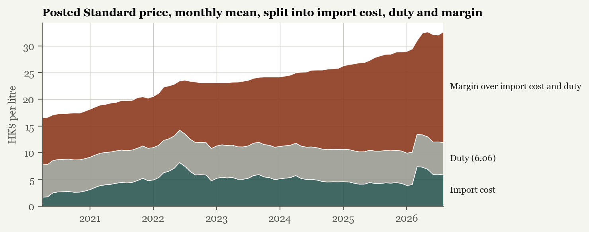

# Fuel Lockstep

Hong Kong's five petrol brands (Caltex, Esso, PetroChina, Shell and Sinopec) almost always post the same pump price. This project rebuilds every posted price change since April 2020 and tests whether the pattern looks like what common costs would produce or shows features costs do not explain. Los Angeles and Perth are the comparison markets.

[Interactive site](https://lyhjeremy.github.io/fuel-lockstep/) · [Write-up](https://lyhjeremy.github.io/fuel-lockstep/overview/) · [Paper (PDF)](https://lyhjeremy.github.io/fuel-lockstep/paper/fuel-lockstep.pdf) · [Essay version (PDF)](https://lyhjeremy.github.io/fuel-lockstep/paper/fuel-lockstep-essay.pdf)

Design and copy follow [these standards](https://github.com/lyhjeremy/lyhjeremy/blob/main/DESIGN_STANDARDS.md).

## Results

- All five brands posted the same Standard price on 87.6% of 2,373 days (30 April 2020 to October 2026).
- Of 143 price changes, all five brands matched within a week 90% of the time (usually within 2 days) and by the same amount in 83% of those. All five moved on the same day 1.4% of the time. When one brand moved alone it was Shell 37 times, Esso 17 and Caltex 12.
- 110 changes were increases and 33 were cuts. In 2023 and 2024 there were 17 increases and no cuts.
- The margin over import cost and the HK$6.06 duty averaged HK$8.76 a litre in the first twelve months and HK$19.03 in the last twelve. On the average price after walk-in discounts it went from HK$6.74 to HK$13.11. From January 2023 to December 2025 the posted price rose from HK$23.09 to HK$28.89 while the import cost fell from HK$5.23 to HK$4.29.
- Pass-through in the week of a cost change: Hong Kong 30% of a rise against 7% of a fall (p = 0.009); Los Angeles 53% against 23% (p = 0.028); Perth 35% against 3% (p = 0.280, not significant).
- Perth, for contrast: 419 metropolitan stations, a typical daily spread of 38 cents a litre from cheapest to dearest, and a weekly cycle from 155.9 cents on Tuesday to 187.1 on Wednesday.

These are screens, not proof of an agreement. The paper discusses what they can and cannot show under US and Hong Kong competition law.



## Data

| Source | What | Span |
|---|---|---|
| Consumer Council via the data.gov.hk historical archive | posted pump price by brand and grade, 1,210 versions of the file | Apr 2020 to Oct 2026 |
| Consumer Council Oil Price Watch page via the Internet Archive | walk-in discounts by brand, 119 days | 23 November 2020 to 20 July 2026 |
| Census and Statistics Department table 915-91104 | monthly import unit value of unleaded petrol, HK$ per litre | Jan 2013 to Aug 2026 |
| US Energy Information Administration | weekly retail (Los Angeles, California, US), daily spot (Los Angeles RBOB, Gulf Coast), Brent | 1986 to 2026 |
| FuelWatch Western Australia | daily price at every Perth metropolitan station, unleaded | Jan 2020 to Sep 2026 |
| FRED | HKD and AUD exchange rates | daily |

Each data decision (the archive's label change, one-snapshot feed faults in the premium series, Perth's Tuesday price) is in [`docs/decisions.md`](docs/decisions.md).

## How to run

```bash
pip install -r requirements.txt
python scripts/fetch_hk_archive.py      # 1,210 archived versions into data/raw/ (slow, about 30 minutes)
python scripts/build_hk_panel.py        # data/hk_daily.csv
python scripts/fetch_hk_discounts.py    # Internet Archive captures into data/raw/, data/hk_walkin_discounts.csv
python scripts/fetch_csd.py             # data/hk_import_unit_value.csv
python scripts/fetch_eia.py             # data/eia.csv
python scripts/fetch_fx.py              # data/fx.csv
FUEL_CACHE=/tmp/wa python scripts/fetch_wa.py   # about 600 MB of monthly files to the cache; keeps data/wa_perth_ulp.csv.gz
python scripts/run_all.py               # results/
python scripts/make_exhibits.py         # paper/figures/
python scripts/export_numbers.py        # paper/numbers.tex, site/numbers.json
python scripts/export_web.py            # assets/data.json
python scripts/export_essay_data.py   # figure data and numbers for the essay
(cd paper && latexmk -pdf main.tex)
(cd paper/essay && latexmk -pdf essay.tex)
python scripts/build_site.py            # index.html, README.md, write-up fragment; copies both PDFs
```

The processed data in `data/` is committed, so `run_all.py` onward works without downloading anything.

## Repo layout

| Path | Contents |
|---|---|
| `scripts/` | fetchers, the analysis runner, exhibit and site builders |
| `analysis/` | `lockstep.py` (alignment and change episodes), `passthrough.py` (asymmetric error-correction model) |
| `data/` | processed inputs; `data/raw/` is gitignored |
| `results/` | every output the paper and site quote, plus `passthrough_robustness.csv` |
| `paper/` | LaTeX source, figures and the PDF; `paper/essay/` is a shorter essay version with pgfplots figures |
| `index.html`, `assets/` | the interactive site |
| `overview/` | the write-up, generated from `site/overview.fragment.html` by the shared overview builder |
| `docs/` | spec and data decisions |

Stack: Python (pandas, statsmodels, matplotlib), LaTeX, and plain HTML, CSS and JavaScript with no libraries for the site. Hosted on GitHub Pages.

## License

Code under the MIT License. Data belongs to its publishers: the Consumer Council and Census and Statistics Department (Hong Kong), the US Energy Information Administration, the Government of Western Australia (FuelWatch) and the Federal Reserve Bank of St. Louis (FRED).
